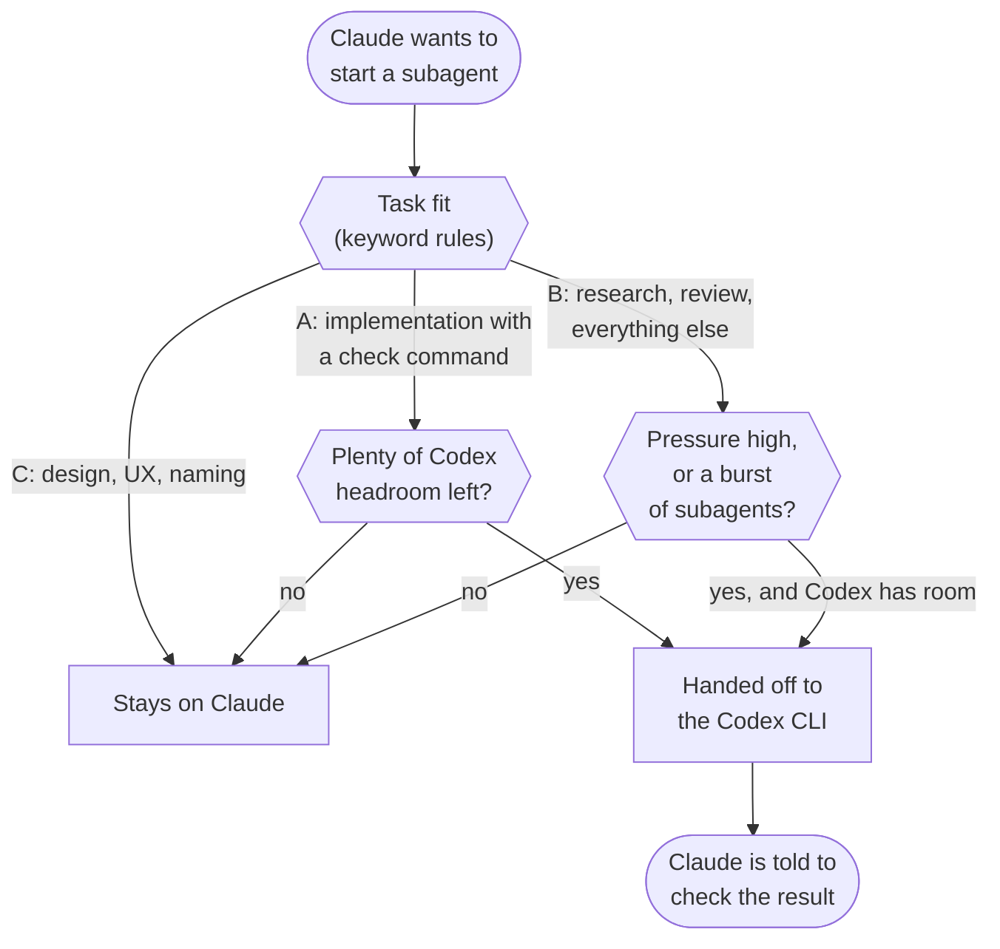

<p align="center">
  
</p>

<h1 align="center">agent-crossfeed</h1>

<p align="center"><strong>Dynamic subagent routing from Claude Code to Codex, paced by Claude's usage limits.</strong></p>

<p align="center">
  <a href="https://github.com/yaokaiy/agent-crossfeed/actions/workflows/ci.yml"></a>
  <a href="LICENSE"></a>
</p>

agent-crossfeed is a Claude Code plugin for people who also have a Codex
subscription. Each time Claude is about to start a subagent, crossfeed
decides whether that work should stay on Claude or go to the Codex CLI. It
decides from three signals: what kind of task the brief describes, how fast
Claude's 5-hour window is filling, and how much Codex quota is left. When
the work should move, crossfeed refuses the subagent call and hands Claude
one command that runs the same brief on Codex. Claude keeps planning the
work and talking to you, and is told to check what comes back.

It also watches Claude's model-scoped weekly limits, such as the one
Claude Code's `/usage` shows for Fable. While one is being used faster than
an even pace, subagents that would run on that model go to Codex or run on
a cheaper Claude model, and the main loop is asked to keep the scarce model
for planning, decisions and review.



The default `auto` mode, for calls Codex can take, while both quotas can be
read. Pressure is a value crossfeed raises while Claude's window is on pace
to fill. [How it routes](#how-it-routes) has the numbers.

## Why

Claude's 5-hour usage window stops every Claude session when it fills. Much
of what fills it is execution: subagents, and long runs of commands and
edits. Several subagents started together can fill a window within half an
hour.

Some models also have a weekly limit of their own. In one heavy user's logs
it ran out before its reset three weeks in a row, once 2.3 days into the
week while the all-model week was at 54%. In that week about 28% of the
model's use (weighted by API prices) came from subagents that never asked
for it and inherited it from the main loop.

If you also pay for Codex, that quota may be sitting unused while Claude is
locked. A usage meter shows you this, and a delegation command lets you
move one task by hand. crossfeed decides for every subagent call at the
moment it starts, and says why.

The name comes from aviation, where crossfeed lets an engine draw fuel from
the other side's tank so that neither runs dry first.

## Measured so far

The first five rows come from one heavy user's Claude Code logs. "Routable"
means a subagent call crossfeed would consider: a general-purpose call with
a brief of 100 characters or more. The last three rows come from building
crossfeed itself, where implementation jobs were given to Codex by hand
with the same kind of brief and check the plugin uses.

| Measure | Result |
| --- | --- |
| Lockouts of the 5-hour window in the 30 days before installing | 6, with Claude locked for 12.9 hours in total |
| Of those, windows in which three or more routable subagents started within 10 minutes | 3 of the 6 |
| Share of a locked window's usage that came from routable subagents | about a quarter (median; 4% to 42%) |
| Fastest burn on record, on the first day installed | 7 routable subagents started within 73 seconds, and the window was full 29 minutes after its reset |
| Share of that window's usage from routable subagents | 63% |
| Implementation jobs handed to Codex with a test command | 10, and all 10 passed their tests on first delivery |
| Codex time per job | 7 minutes (median; 5 to 16) |
| Codex quota used | about 5 points of one week's quota on that user's plan, two review jobs included |

Usage shares are estimates: tokens are weighted by API price ratios,
because the subscription's own weighting is not published. Nothing was
handed off during the fastest burn: version 0.1.0 could not find Codex in
that session. Version 0.1.1 fixed that and added the rule for bursts. A
before and after count of lockouts needs more weeks of use and is not in
yet.

## Quick start

You need [Claude Code](https://code.claude.com/docs) 2.1.325 or later on a
subscription plan, the Codex CLI 0.167 or later (logged in with
`codex login`), Python 3.9 or later, and git. macOS and Linux are supported.

At the prompt of a Claude Code terminal session:

```
/plugin install agent-crossfeed --marketplace yaokaiy/agent-crossfeed
```

Or from a shell:

```bash
claude plugin install agent-crossfeed --marketplace yaokaiy/agent-crossfeed
```

There is nothing else to set up. A line under the prompt shows what
crossfeed sees:

```
crossfeed auto · claude 5h 62% (pace 104%) · 7d 41% · codex wk 17% · pressure 0.4
```

Work as usual. When a subagent call should move, crossfeed refuses it and
tells Claude what to run instead. [Install notes](#install-notes) covers permissions, where `codex` is looked
up, and removal.

## What a hand-off looks like

crossfeed refuses the subagent call and gives Claude one command to run
instead:

```
crossfeed: run this on Codex instead of a Claude subagent.
Why: tier A (has a check command and is implementation-type work). Claude 5h 62%, on pace for 104%; Codex weekly 17%.
The brief you just wrote is saved. Start this as a background Bash command:
python3 -I '.../scripts/crossfeed.py' run --tier A --kind subagent --dir '/your/repo' --write --brief-file '.../briefs/20260101-120000-ab12.md'
Add --write if the task must change files, drop it if not. Wait for the exit notification and do not poll. Check the result before you report it.
```

Claude is told to start the command in the background, where waiting costs
no model turns. When it exits, Claude Code notifies Claude, which reads its
output:

```
[crossfeed] job 20260101-120000-ab12 done in 1m32s; tier A; kind subagent; sandbox workspace-write; codex tokens 48210
[crossfeed] changed 2 file(s): calc.py, test_calc.py
[crossfeed] record the outcome: python3 -I .../scripts/crossfeed.py check 20260101-120000-ab12 -- <your check command>
```

Claude is told to run the brief's check through `crossfeed.py check`, which
records pass or fail, and then to report to you.

## How it routes

For each subagent call crossfeed asks four questions.

1. **Fit.** What kind of task is this? The answer comes from keyword rules
   on the call's description and brief.

   | Tier | Work | Handed to Codex |
   | --- | --- | --- |
   | A | a brief that names a check command (`pytest`, `npm test`, `cargo test` and similar) and reads as implementation work: implement, refactor, migrate, fix failing tests, reproduce, triage logs | while headroom is at least one half: Codex's weekly use below 75 to 80%, depending on how near its reset is, and any short window below 90% |
   | B | everything else that is eligible: research, reading code, review, implementation without a recognised check command | when pressure reaches 0.3, while Codex has any headroom |
   | C | briefs under 100 characters, and calls whose description or opening lines contain design, architecture, UX, front-end, naming or brainstorming keywords | never |

2. **Pressure.** How fast is Claude's 5-hour window filling? crossfeed
   forecasts where the window will end at the current pace. It raises a
   pressure value in small steps while that forecast is above 95% and lowers
   it when the forecast is below 80%. Tier B work moves once pressure
   reaches 0.3; tier A does not wait for it.

3. **Headroom.** How much Codex quota is left? A headroom value falls from
   1 to 0 over the last 10 to 20 points before Codex's weekly use reaches
   85%. Tier A work stops moving when it drops below one half and tier B
   when it reaches 0, which leaves quota for your own Codex work. A job
   that is already running is not stopped.

4. **Model limits.** Is a model's own weekly limit going too fast?
   crossfeed reads these limits from Claude Code's `/usage` (no model call)
   every 10 minutes or so while you work. A limit counts as ahead when its
   use is 5 points past an even pace for the week, or at 80%. Then a
   subagent call that would run on that model is decided as if pressure
   were 0.3, so tier B work goes to Codex. A `general-purpose` or `claude`
   subagent that stays on Claude and named no model runs on the
   `premiumFallback` model instead (Opus by default), but only when that
   model is cheaper (Haiku, then Sonnet, Opus, Fable) and its own limit is
   not ahead too; once the limit is used up, so does one that named it. When your main loop runs on that
   model, Claude gets one notice asking it to keep the model for planning,
   decisions and review, and to tell you once about `/model opus` with
   `/advisor` (Claude Code's setting for consulting a stronger model at key
   moments). crossfeed never switches your main model itself.

The forecast cannot see subagents that have just started, so two more
rules apply. Once two calls that could have been handed off (tier A or B)
have stayed on Claude within 10 minutes, further tier B calls in that time
go to Codex too, while it has headroom. And a window that begins within two
hours of a locked window's reset starts with pressure already raised; that
start counts for the window's first 30 minutes.

If either quota cannot be read, nothing is handed off, and `/crossfeed
status` names the reason. By default a call is considered when it names no
agent type or one of the general-purpose types (the `eligibleTypes`
option). Other agent types, calls pinned to the `haiku` model, named or
remote agents, calls made by a subagent itself, and briefs that mention
browser tools or other Claude-only tools crossfeed recognises stay on
Claude.

The exact rules and formulas are in [docs/design.md](docs/design.md).

## What you get

- A routing decision for every subagent call, with its reason in one line.
  `/crossfeed status` shows the readings, the pressure, what would be
  handed off now, and why the last call was or was not.
- A one-line notice to Claude when pressure first reaches the level at
  which tier B work moves and when the window reaches 90%, and a reminder
  after a long run of hands-on tool calls while pressure is high or the
  main loop's model limit is ahead.
- Subagents moved off a model whose weekly limit is ahead, each one logged
  and recorded.
- A local record of every finished job: how long it took, the Codex token
  count it reported, and, when a check was run, whether it passed.
  `/crossfeed report` sums up the last 7 days, including the lockouts it
  saw.
- It fails open. If the plugin itself errors, the subagent call goes ahead
  on Claude, unchanged.
- A small footprint: no daemon, no database, no MCP server. The dispatcher
  is one Python file that uses only the standard library, and it also works
  [without the plugin](#the-dispatcher).

## Commands

| Command | Effect |
| --- | --- |
| `/crossfeed` or `/crossfeed status` | readings, pressure, what would be handed off now, and why the last subagent call was or was not handed off |
| `/crossfeed report` | the last 7 days: lockouts seen (5-hour and model limits), subagents moved to a cheaper model, jobs, tokens, results of the first check recorded for each job |
| `/crossfeed always` | hand off every tier A and B call while Codex has room (this session) |
| `/crossfeed auto` | back to the default (this session) |
| `/crossfeed off` | stop steering, keep the record (this session) |

When Codex's quota cannot be read the status line says `codex unavailable`,
and a reading older than 15 minutes is marked `stale`. Nothing is handed
off in either state. A model limit appears in the status line, as
`fable wk 62% ahead` for example, when your main loop runs on that model or
the limit is ahead or used up.

## Options

Set them with `/plugin configure agent-crossfeed@agent-crossfeed`.

| Option | Default | Meaning |
| --- | --- | --- |
| `mode` | `auto` | `auto`, `always` or `off` |
| `effort` | `high` | Codex reasoning effort for hand-offs |
| `model` | empty | Codex model; empty uses your Codex configuration |
| `premiumFallback` | `opus` | Claude model for subagents moved off a model whose weekly limit is ahead; empty turns this off |
| `eligibleTypes` | `general-purpose,claude` | subagent types that may be redirected to Codex |
| `stretchCalls` | `12` | hands-on tool calls since your last prompt before the one reminder sent while pressure is high |
| `codexStopPercent` | `85` | Codex weekly use at which hand-offs stop |
| `timeoutMinutes` | `30` | time limit for one job |

## The dispatcher

`scripts/crossfeed.py` works without the plugin. Write the task into a file,
here `brief.md`, and use the job id that `run` prints:

```bash
python3 -I scripts/crossfeed.py run --tier A --dir "$PWD" --write < brief.md
python3 -I scripts/crossfeed.py check 20260101-120000-ab12 -- pytest -q
python3 -I scripts/crossfeed.py quota
python3 -I scripts/crossfeed.py report
```

`run` puts a fixed preamble before the brief (stay in the directory, never
push, commit or post, answer in at most 40 lines), runs `codex exec` asking
for Codex's read-only sandbox, or for `workspace-write` with `--write`, and
prints the result capped at 60 lines. For a write job in a git repository it
compares the modified and untracked files before and after, lists the ones
that changed, and warns when `HEAD` moved. Jobs run with `--worktree` and
directories outside git get no change list. `--brief-file PATH` reads the
brief from a file instead of standard input, and `stash` saves standard
input to such a file and prints its path; the plugin uses the pair.

Exit codes of `run`: 0 done, 1 failed, 2 usage error, 75 Codex reported its
usage limit, 124 timeout, 127 Codex not found, 130 interrupted. On a timeout
or an interrupt the Codex process group is stopped.

`check` runs your check command and records pass or fail for the job. The
verdict comes from the command's exit status, not from the model.

## Install notes

crossfeed uses Claude Code's function-hook plugin API, which is early access
and may change.

It looks for `codex` in `$CROSSFEED_CODEX` when that is set and not empty,
then on `PATH`, then in the usual install directories listed in
[the design](docs/design.md#the-dispatcher). If your Codex is somewhere
else and Claude Code runs with a `PATH` that lacks it, set `CROSSFEED_CODEX`
to the executable's path.

Claude Code asks you to approve the dispatcher command when it runs, as it
does for any shell command. To skip that prompt for hand-offs, allow the
dispatcher's `run` command in your Claude Code settings, using the script
path shown in the refusal message:

```json
{
  "permissions": {
    "allow": ["Bash(python3 -I '/path/to/agent-crossfeed/scripts/crossfeed.py' run *)"]
  }
}
```

Do not allow `check` the same way: it runs whatever command you give it.

To try the plugin from a clone for one session:

```bash
claude --plugin-dir /path/to/agent-crossfeed
```

To remove it: `claude plugin uninstall agent-crossfeed@agent-crossfeed`.

## Safety and data

- If a hook of the plugin throws, the subagent call goes ahead on Claude,
  unchanged. If only saving the brief fails, the call is still handed off
  and Claude is told to pass the brief on standard input instead.
- crossfeed asks Codex for its read-only sandbox, or for `workspace-write`
  with `--write`. What those sandboxes permit is decided by Codex and your
  Codex configuration, not by crossfeed.
- crossfeed passes a brief to your Codex CLI and to nothing else. Codex then
  handles it as your Codex configuration says.
- What crossfeed stores stays on your machine, in `$CROSSFEED_HOME`, else
  `$CLAUDE_CONFIG_DIR/crossfeed`, else `~/.claude/crossfeed`: a ledger with
  one line per finished job, check and lockout, the saved briefs, and each
  job's event log and result. Files are created readable by you only. A
  check is recorded by program name, without its arguments.

To report a vulnerability, see [SECURITY.md](SECURITY.md).

## Status and limits

Version 0.2.1 is an early release.

- Hand-offs aim to make lockouts rarer and later. A before and after count
  is not in yet (see [Measured so far](#measured-so-far)), and what the
  hand-offs themselves cost in Claude usage has not been measured.
- The tiers are keyword heuristics informed by published benchmarks and one
  practitioner's routing rules, not by your tasks. They will misfile some
  briefs. `/crossfeed report` shows check results per tier so you can see
  whether they hold for you.
- Subagent calls are counted per session. Subagents started from two
  sessions at once are not seen as one burst, and subagents that are
  already running cannot be moved.
- In a very heavy window only part of the usage can move, so a lockout can
  still happen.
- A Codex job starts with none of the conversation's context. Thin briefs
  give poor results.
- Running the command in the background and checking the result are
  instructions to the model, not something the plugin can enforce.
- The pressure controller's constants were calculated, not tuned on
  measurements, and most are fixed in code. The model-limit thresholds
  come from replaying three weeks of one user's logs.
- Model limits are read from text Claude Code prints for people. If the
  lines crossfeed reads change, it stops seeing model limits until it is
  updated. If only a reset time cannot be read, it uses the all-model
  weekly reset time, or acts only from 80% when there is none.
- Most of a scarce model's use is usually the main loop, which crossfeed
  does not move. Whether `/advisor` calls count toward the advised model's
  weekly limit has not been measured.
- Continuing a task on Codex after Claude is locked out is planned and not
  in this version.

## Research behind the design

The routing rules draw on published work on LLM routing, budget pacing and
coding-agent teams. crossfeed does not reproduce these papers' results, and
its own thresholds have not been tuned on measurements yet.

| Paper | What crossfeed takes from it |
| --- | --- |
| Ong et al., [RouteLLM: Learning to Route LLMs with Preference Data](https://arxiv.org/abs/2406.18665) (2024) | Routing is decided per request. "Which model suits this task" is a separate question from "how tight is the budget". |
| Ding et al., [Hybrid LLM: Cost-Efficient and Quality-Aware Query Routing](https://arxiv.org/abs/2404.14618) (2024) | How much work goes to the other model can be tuned at run time. In crossfeed's default mode that tuning comes from pressure: tier B work moves when pressure, or the burst rule, reaches the threshold. |
| Chen, Zaharia and Zou, [FrugalGPT: How to Use Large Language Models While Reducing Cost and Improving Performance](https://arxiv.org/abs/2305.05176) (2023) | Choosing the model per query can cut cost at the same quality. Unlike the paper's cascade, crossfeed routes each call once, because a second attempt would spend quota too. |
| Taberner-Miller, [ParetoBandit: Budget-Paced Adaptive Routing for Non-Stationary LLM Serving](https://arxiv.org/abs/2604.00136) (2026) | Budget pacing as a closed loop. The pressure controller reacts to a forecast of the window in place of a fixed threshold. |
| Qin et al., [Pathwise-Budgeted LLM Routing: Online Allocation with K-Bit Tail-Cost Learning](https://arxiv.org/abs/2611.05835) (2026) | One expensive task can exhaust what is left of a budget, so the controller's line for "too fast" is a forecast of 95%, which leaves a margin below a full window. |
| Samway et al., [Scaling Inference-Time Compute with Teams of Coding Agents](https://arxiv.org/abs/2610.17471) (2026) | What delegation buys depends on the stage that is delegated and on the models in the team. crossfeed judges fit per brief and records outcomes per tier, so its rules can be corrected. |
| Xiang et al., [Cross-Model LLM Code Review: Should you use Claude to review Codex or vice versa?](https://arxiv.org/abs/2607.21656) (2026) | In the paper Claude's review raised Codex drafts from 71.6% to 89.7% on 116 tasks, and the reverse order did not pay off. In crossfeed Codex does the work and Claude is told to check the result before reporting it. |
| Huang et al., [SWE-Shift: Evaluating Coding Agents in Evolving Workspaces](https://arxiv.org/abs/2610.32196) (2026) | Every coding agent the paper tested did worse when the task changed during a run. Tier A asks for a check command in the brief, and briefs that open with design keywords stay on Claude. |

The full source list, including the benchmarks consulted, is in
[docs/design.md](docs/design.md#references).

## Contributing

```bash
make test
```

See [CONTRIBUTING.md](CONTRIBUTING.md) and the
[code of conduct](CODE_OF_CONDUCT.md).

## License

[MIT](LICENSE)

agent-crossfeed is an independent project, not affiliated with or endorsed
by Anthropic or OpenAI.
