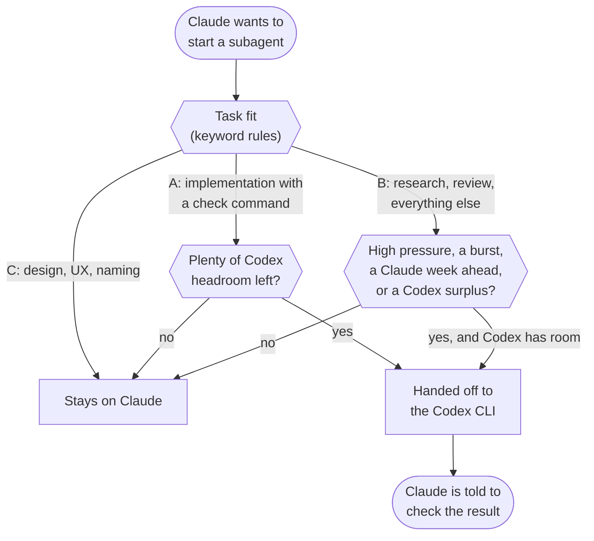

<p align="center">
  
</p>

<h1 align="center">agent-crossfeed</h1>

<p align="center"><strong>Spend your Codex quota on subagent work before Claude's usage limit locks you out.</strong></p>

<p align="center">
  <a href="https://github.com/yaokaiy/agent-crossfeed/actions/workflows/ci.yml"></a>
  <a href="LICENSE"></a>
</p>

When Claude's 5-hour window fills, you are locked out of Claude until it
resets. A model's weekly limit, such as Fable's, can run out days early. If
you also pay for Codex, that quota may be sitting unused at the same moment.
agent-crossfeed is a Claude Code plugin that hands suitable subagent work to
the Codex CLI while Codex has room, more of it as Claude's limits fill
faster. The aim is fewer and later lockouts.

- **Decides each subagent call from the main loop as it starts**, from what the brief asks
  for, how fast Claude's limits are filling and how much Codex quota is
  left.
- **Moves work off a scarce model.** While a model's weekly limit is ahead
  of an even pace, research and review that would use it can go to Codex,
  and subagents that only inherit it from your main loop can run on a
  cheaper Claude model.
- **Keeps you in one conversation.** A hand-off refuses the subagent call
  and gives Claude one command that runs the same brief on Codex; Claude is
  told to check what comes back.



The default `auto` mode, for calls Codex can take, while both quotas can be
read. Pressure is a value crossfeed raises while Claude's window is on pace
to fill. [How it routes](#how-it-routes) has the numbers.

## Why

Much of what fills Claude's 5-hour window is execution: subagents, and long
runs of commands and edits. Several subagents started together can fill a
window within half an hour.

Some models also have a weekly limit of their own. In one heavy user's logs
it ran out before its reset three weeks in a row, once 2.3 days into the
week while the all-model week was at 54%. In that week about 28% of the
model's use (weighted by API prices) came from subagents that never asked
for it and inherited it from the main loop.

A usage meter shows how fast you are using Claude, and a delegation
command lets you move one task by hand. crossfeed decides for every
subagent call from the main loop at the moment it starts, and says why.

The name comes from aviation, where crossfeed lets an engine draw fuel from
the other side's tank so that neither runs dry first.

## Measured so far

The first five rows come from one heavy user's Claude Code logs. "Routable"
means a subagent call crossfeed would consider: a general-purpose call with
a brief of 100 characters or more. The last three rows come from building
crossfeed itself, where implementation jobs were given to Codex by hand
with the same kind of brief and check the plugin uses.

| Measure | Result |
| --- | --- |
| Lockouts of the 5-hour window in the 30 days before installing | 6, with Claude locked for 12.9 hours in total |
| Of those, windows in which three or more routable subagents started within 10 minutes | 3 of the 6 |
| Share of a locked window's usage that came from routable subagents | about a quarter (median; 4% to 42%) |
| Fastest burn on record, on the first day installed | 7 routable subagents started within 73 seconds, and the window was full 29 minutes after its reset |
| Share of that window's usage from routable subagents | 63% |
| Implementation jobs handed to Codex with a test command | 10, and all 10 passed their tests on first delivery |
| Codex time per job | 7 minutes (median; 5 to 16) |
| Codex quota used | about 5 points of one week's quota on that user's plan, two review jobs included |

Usage shares are estimates: tokens are weighted by API price ratios,
because the subscription's own weighting is not published. Nothing was
handed off during the fastest burn: version 0.1.0 could not find Codex in
that session. Version 0.1.1 fixed that and added the rule for bursts. A
before and after count of lockouts needs more weeks of use and is not in
yet.

## Quick start

You need [Claude Code](https://code.claude.com/docs) 2.1.325 or later on a
subscription plan, the Codex CLI 0.167 or later (logged in with
`codex login`), Python 3.9 or later, and git. macOS and Linux are supported.

At the prompt of a Claude Code terminal session:

```
/plugin install agent-crossfeed --marketplace yaokaiy/agent-crossfeed
```

Or from a shell:

```bash
claude plugin install agent-crossfeed --marketplace yaokaiy/agent-crossfeed
```

There is nothing else to set up. A line under the prompt shows what
crossfeed sees:

```
crossfeed auto · claude 5h 62% (pace 104%) · 7d 41% · codex wk 17% · pressure 0.4
```

Work as usual. When a subagent call should move, crossfeed refuses it and
tells Claude what to run instead. [Install notes](#install-notes) covers permissions, where `codex` is looked
up, and removal.

## What a hand-off looks like

crossfeed refuses the subagent call and gives Claude one command to run
instead:

```
crossfeed: run this on Codex instead of a Claude subagent.
Why: tier A (has a check command and is implementation-type work). Claude 5h 62%, on pace for 104%; Codex weekly 17%.
The brief you just wrote is saved. Start this as a background Bash command:
python3 -I '.../scripts/crossfeed.py' run --tier A --kind subagent --dir '/your/repo' --write --brief-file '.../briefs/20260101-120000-ab12.md'
Add --write if the task must change files, drop it if not. Wait for the exit notification and do not poll. Check the result before you report it.
```

Claude is told to start the command in the background, where waiting costs
no model turns. When it exits, Claude Code notifies Claude, which reads its
output:

```
[crossfeed] job 20260101-120000-ab12 done in 1m32s; tier A; kind subagent; sandbox workspace-write; codex tokens 48210
[crossfeed] changed 2 file(s): calc.py, test_calc.py
[crossfeed] full result: .../jobs/20260101-120000-ab12/result.md
[crossfeed] record the outcome: python3 -I .../scripts/crossfeed.py check 20260101-120000-ab12 -- <your check command>
```

After a write job, Claude is told to run the brief's check through
`crossfeed.py check`, which records pass or fail, and then to report to you. After a read-only job
that succeeded, such as a review, it is told to verify the job's claims and
record through `crossfeed.py used` whether it used the result.

When weekly usage tips a tier B decision, the refusal gives the figures
from that decision. For example, a command with `--cause codex-surplus`
can have this explanation:

```
Why: tier B; Codex weekly 40% used, 38 points under an even pace to its 85% stop.
```

## How it routes

For each subagent call from the main loop crossfeed asks four questions.
A workflow's agents are not handed to Codex; see **Background work** below.

1. **Fit.** What kind of task is this? The answer comes from keyword rules
   on the call's description and brief.

   | Tier | Work | Handed to Codex in `auto` |
   | --- | --- | --- |
   | A | a brief that names a check command (`pytest`, `npm test`, `cargo test` and similar) and reads as implementation work: implement, refactor, migrate, fix failing tests, reproduce, triage logs | at headroom of at least one half |
   | B | everything else that is eligible: research, reading code, review, implementation without a recognised check command | at pressure of at least 0.3, including the weekly and burst rules below, with any positive headroom |
   | C | briefs under 100 characters, and calls whose description or opening lines contain design, architecture, UX, front-end, naming or brainstorming keywords | never |

2. **Pressure.** How fast is Claude's 5-hour window filling? crossfeed
   forecasts where the window will end at the current pace. It raises a
   pressure value in small steps while that forecast is above 95% and lowers
   it when the forecast is below 80%. Tier B work moves once pressure
   reaches 0.3. Claude's all-models week can also move tier B. The week is
   ahead at 5 percentage points or more above the fraction of the week
   elapsed, or at 90% used, and full at 100%. For example, 55% used
   halfway through the week is ahead. This rule needs a known future reset.

3. **Headroom.** How much Codex quota is left? A headroom value falls from
   1 to 0 over the last 10 to 20 points before Codex's weekly stop
   (85% by default). A short window of 6 hours or less gives zero
   headroom at 90%. In `auto`, tier A needs headroom of at least one half
   and tier B needs positive headroom, which leaves quota for your own
   Codex work. A job
   that is already running is not stopped. Windows that have reset do not
   count. On the longest window over 6 hours, crossfeed also checks the
   surplus against an even pace to the configured stop. Halfway through
   the week with an 85% stop, 25% used leaves 17.5 points (42.5 minus 25). A
   surplus of at least 15 points with headroom of at least one half can
   move tier B even at low pressure.

4. **Model limits.** Is a model's own weekly limit going too fast?
   crossfeed reads these limits from Claude Code's `/usage` (no model call)
   every 10 minutes or so while you work. A limit counts as ahead when its
   use is 5 points past an even pace for the week, or at 80%. Then a
   subagent call that would run on that model is decided as if pressure
   were 0.3, so tier B work goes to Codex. A `general-purpose`, `claude`, or
   `workflow-subagent` agent that is not a fork, stays on Claude and inherits
   its model is started on `premiumFallback` (Opus by default) when the
   fallback family is cheaper and its own limit is neither ahead nor full.
   Claude Code can keep the original model, for example for a resumed agent. Once the limit is used up, the
   fallback applies to a subagent that named the model too. When your main loop runs on that
   model and main-loop hand-offs are on, the ahead notice asks Claude to
   keep planning, decisions and review here and hand execution to Codex.
   The full notice reports that the limit is used up and names the
   fallback if available or advises handing execution to Codex. Either
   notice can suggest switching to the fallback with `/model` and consulting
   Fable, Opus or Sonnet at key moments with `/advisor`. crossfeed never
   switches your main model itself.

The forecast cannot see subagents that have just started, so two more
rules apply. Once two calls that could have been handed off (tier A or B)
have stayed on Claude within 10 minutes, further tier B calls in that time
go to Codex too, while it has headroom. And a window that begins within two
hours of a locked window's reset starts with pressure already raised; that
start counts for the window's first 30 minutes.

Unknown Codex headroom blocks hand-offs to Codex. Without Claude's 5-hour
reading, a subagent call can still move if its model's weekly limit is
ahead or used up. Weekly signals or `always` can still prompt main-loop
hand-offs with enough headroom. `/crossfeed status` names the reason.
By default a call is considered when it names no
agent type or one of the general-purpose types (the `eligibleTypes`
option). Other agent types, calls pinned to the `haiku` model, named or
remote agents, calls made by a subagent itself, and briefs that mention
browser tools or other Claude-only tools crossfeed recognises stay on
Claude.

**In the main loop**, hand-offs are on when pressure reaches 0.3 with a
5-hour reading, the main model's week or the all-models week is ahead or
full, the Codex surplus is active, or the mode is `always`. Each needs
headroom of at least one half. Mode `off` disables steering. At 90% of
Claude's 5-hour window the reserve takes precedence over every hand-off
notice. Claude is asked to finish the current step, keep a hand-off note
and start no new autonomous work. Subagent calls still use the rules above.

An all-models week ahead or full, an active surplus, or `always` triggers
a balance notice saying “hand-offs are on.” Before the first command of
each task, Claude is asked to hand Codex execution with a result it can
check, such as fixing failing tests or running three dependent shell steps.
Conversation, design decisions, Claude-only tools and edits under about
20 lines stay with Claude. For each ordinary user prompt, the first
counted main-loop call at or beyond `stretchCalls` while hand-offs are on
gives a reminder with the reasons and a `run --kind task` command.

After an on notice, known headroom below one half triggers “hand-offs are
off.” With enough headroom, that notice waits until no reason holds, the
Claude week is on pace and less than 2 points above the even-pace line,
and the Codex surplus is below 10 points. Missing readings alone do not
trigger it. The off notice asks Claude to do execution itself unless a
subagent call is refused.

**Background work.** Codex hand-offs are decided on the main loop's Agent
calls, and a workflow's agents start on Claude. A few workflows running at
once can fill the 5-hour window before the pressure rule reacts, so
crossfeed also checks every agent start Claude Code exposes. The window is
short at `shedPercent` (85% by default), or when the current pace would
fill it within 15 minutes and before its reset. While it is short,
crossfeed refuses workflow agents, background agents and the agents they
start. This check lets a subagent the main loop waits for through; the
usual hand-off rules still apply to it. At the first reading at or above
the shed line, the breaker selects the background workflows, agents and
teammates this conversation has registered and tries to stop them with
TaskStop. It reports explicit denials and retries those tasks on later
readings at or above the line. A pace crossing while this conversation has
a registered task, or a breaker stop or denial, can wake an idle main loop
with one prompt per window. The count is kept in memory, so it starts over
when the plugin reloads or the conversation is resumed. A pace warning can
arrive before anything stops. Breaker messages name the stopped tasks or
denied stops and how to resume each stopped workflow with a known run ID.
Other messages are queued for Claude's next eligible main-loop tool result
or ordinary prompt and, with `wake` on, also appear as a toast. With `wake`
set to false crossfeed only queues them. Mode `off` turns all of this off.

The exact rules and formulas are in [docs/design.md](docs/design.md).

## What you get

- A routing decision for every subagent call from the main loop, with its
  reason in one line.
  `/crossfeed status` shows the readings, the pressure, what would be
  handed off now, and why the last call was or was not.
- Notices about pressure, weekly balance and the 5-hour reserve, and at
  most one stretch reminder per ordinary user prompt when a counted call
  reaches or passes `stretchCalls` while hand-offs are on.
- Subagents moved off a model whose weekly limit is ahead, each one logged
  and recorded.
- Protection against background fan-out: new background agents are refused
  while the 5-hour window is short, and at the shed line the breaker tries
  to stop this conversation's registered background tasks.
- A local record of each routing decision outside `off` mode (a decision
  whose write fails is logged and left out), with its reason and the
  readings it rested on, and of every finished job: how long it took, the
  Codex token count it reported, and, when recorded, whether its check
  passed or its result was used. `/crossfeed report` sums up the last 7
  days, including the lockouts it saw.
- It fails open. If the plugin itself errors, the subagent call goes ahead
  on Claude, unchanged.
- A small footprint: no daemon, no database, no MCP server. The dispatcher
  is one Python file that uses only the standard library, and it also works
  [without the plugin](#the-dispatcher).

## Commands

| Command | Effect |
| --- | --- |
| `/crossfeed` or `/crossfeed status` | Claude's all-models pace and state, Codex surplus and headroom, pressure, current main-loop hand-off reasons, the 5-hour short-window state, tier decisions and the last subagent decision |
| `/crossfeed report` | the last 7 days of lockouts, model downgrades, subagent decisions, jobs by cause and model, stopped launches, notices and reminders, tokens, first checks, use of read-only results, agent starts by origin and outcome, breaker stops and wake-ups. Agent-start, breaker and wake-up counts show as unavailable until the ledger contains a valid event of one of those kinds. |
| `/crossfeed always` | this session, hand off eligible tier A and B calls with positive Codex headroom and either a Claude 5-hour reading or an ahead or full limit for the call's model family |
| `/crossfeed auto` | back to the default (this session) |
| `/crossfeed off` | stop steering, keep the record (this session) |

When Codex's quota cannot be read the status line says `codex unavailable`,
and a reading older than 15 minutes is marked `stale`. Nothing is handed
off in either state. A model limit appears in the status line, as
`fable wk 62% ahead` for example, when your main loop runs on that model or
the limit is ahead or used up. `7d 79% ahead` marks an all-models week
ahead or full. In `codex wk 40% +38`, 40% is usage and 38 is the active
surplus in whole percentage points.

## Options

Set them with `/plugin configure agent-crossfeed@agent-crossfeed`.

| Option | Default | Meaning |
| --- | --- | --- |
| `mode` | `auto` | auto routes on both quotas; always hands off every eligible tier A and B call while Codex has headroom and Claude's 5-hour usage is known (or the call's model limit is ahead or full); off stops steering. |
| `effort` | `high` | Codex reasoning effort for jobs handed out from a refused subagent call. |
| `model` | empty | Model for jobs handed out from a refused subagent call. Leave empty to let crossfeed choose: its judgment model for tier B hand-offs when Codex lists it, otherwise Codex's own default. |
| `premiumFallback` | `opus` | Model for subagents moved off a model whose weekly limit is ahead of pace. Leave empty to turn this off. |
| `eligibleTypes` | `general-purpose,claude` | Comma-separated subagent types whose briefs can be handed to Codex. |
| `stretchCalls` | `12` | Counted hands-on main-loop tool calls in one prompt before the one hand-off reminder, sent while hand-offs are on. |
| `codexStopPercent` | `85` | Stop handing off new work when a long Codex quota window reaches this percentage. Use a value greater than 0 and at most 100. |
| `shedPercent` | `85` | Refuse new background Claude agents and try to stop this conversation's registered background tasks when the 5-hour window reaches this percentage. Use a value greater than 0 and at most 100. |
| `wake` | `true` | Allow one wake-up prompt per 5-hour window for an idle coordinator with an attached surface. Reloading the plugin or resuming the conversation resets the allowance. Set to false to queue the message for Claude's next eligible main-loop tool result or ordinary prompt. |
| `timeoutMinutes` | `30` | Codex time limit, in minutes, for jobs handed out from a refused subagent call. |

## The dispatcher

`scripts/crossfeed.py` works without the plugin. Write the task into a file,
here `brief.md`, and use the job id that `run` prints:

```bash
python3 -I scripts/crossfeed.py run --tier A --dir "$PWD" --write < brief.md
python3 -I scripts/crossfeed.py check 20260101-120000-ab12 -- pytest -q
python3 -I scripts/crossfeed.py run --kind review --artifact draft-v1 --dir "$PWD" < review.md
python3 -I scripts/crossfeed.py used 20260101-120500-cd34 partly
python3 -I scripts/crossfeed.py receipt draft-v1 --path draft.md --json
python3 -I scripts/crossfeed.py quota
python3 -I scripts/crossfeed.py report
```

`run` tells Codex to keep changes inside the workspace, permits reads of
paths named in the brief, forbids pushing, committing or posting, and
requests an answer of at most 40 lines. It runs `codex exec` with the
read-only sandbox by default or `workspace-write` with `--write`, and
prints up to 60 lines of the result. For a write job in a git repository it
compares the modified and untracked files before and after, lists the ones
that changed, and warns when `HEAD` moved. Jobs run with `--worktree` and
directories outside git get no change list. `--brief-file PATH` reads the
brief from a file instead of standard input, and `stash` saves standard
input to such a file and prints its path; the plugin uses the pair. Without
`--session`, `run` records the session from `CLAUDE_CODE_SESSION_ID`, which
Claude Code sets in the shells it starts.

A fresh job uses an explicit nonempty `--model` first. Otherwise
`--kind review`, `--kind research` and `--kind subagent --tier B` select
`gpt-6.2-astra` when Codex lists it in its local model cache.
`CROSSFEED_JUDGMENT_MODEL` selects a different listed model, and an empty
value disables the choice. If the judgment model is absent or the cache
cannot be read, crossfeed uses Codex's own default. Other kinds of work,
including `task` (the default kind), also use that default unless you
supply `--model`. `run --resume <job>` keeps the prior model selection.

- `--artifact ID` labels jobs for the same draft or other artifact. Use
  1 to 64 ASCII letters, digits, dots, underscores or hyphens. `run`
  prints the round, one more than the number of earlier successful jobs
  with the same label and kind. A resume inherits the label if present.
  You can repeat the selected job’s label or choose a label if that job has none.
  Use `--kind review` again when the resumed job is a review.
- `--role-file PATH` puts a UTF-8 Markdown role between the preamble and
  the brief. It accepts an optional BOM and strips opening YAML
  frontmatter delimited by `---` lines, so you can use a file from
  `~/.claude/agents/`. The file must be at most 64 KiB and contain a
  nonempty body. `brief.md` stores the brief alone. Use the flag on the
  first turn of a thread.
- `--output-schema PATH` passes a JSON object from a file to Codex as its
  output schema. Codex writes the structured final message to `result.md`.
  The flag works on fresh jobs and resumes with Codex CLI 0.170.0. Supply
  it on each turn that needs the schema.

`receipt ID` looks up the latest successful `review` for an artifact.
Use `--kind KIND` to select a different kind or `--kind any` to look across
all kinds. The receipt includes the job ID, kind, round, timestamps, model,
latest `used` rating, completed rounds for that kind, and paths to
`brief.md` and `result.md`. The receipt takes its verdict from a string
`verdict` in a JSON object in `result.md`. Run the review with
`--output-schema` to produce that result. If `result.md` lacks a JSON object with a string `verdict`, the receipt prints `none` in text output and `null` in JSON output.
Pass `--path PATH` for each file whose modification time you want checked.
A directory argument checks only the directory’s own modification time.
`--json` prints one object with `stale` and `stale_paths` alongside the
job details. Receipt exit codes are 0 for
a match with no stale paths, 1 for no match, 2 for bad input such as a
missing or empty path, and 3 for a match with stale paths.

Jobs Claude starts itself use `run`'s defaults of `--effort high` and
`--timeout 30` unless the command specifies other values. The timeout
covers Codex execution after the quota check.

Before starting or resuming a job, `run` checks Codex's quota. A window
of 6 hours or less stops the launch at 90%. A longer window stops it at
`--codex-stop PERCENT` (default 85, greater than 0 and at most 100).
The plugin includes the flag in its commands for a nondefault stop.
A window counts until its reset. Without a reset it counts only on a
reading at most 15 minutes old. A reported limit also stops the launch on
a reading that fresh with a counted window. With no reading, or one dated
more than 5 minutes ahead, `run` reports unknown quota and proceeds.

Exit codes of `run`: 0 done, 1 failed, 2 usage error, 75 the launch guard
stopped the job or Codex reported its limit, 124 timeout, 127 Codex not
found, 130 for an interrupt handled during an allocated job. A timeout
or a handled interrupt stops the Codex process group if it started. An
interrupt during preflight can end `run` without a job record.

`check` runs your check command and records pass or fail for the job. The
verdict comes from the command's exit status, not from the model. `used`
records whether the result of a successful job was used: `yes`, `partly` or
`no`. That one is the model's own rating, and a later rating replaces an
earlier one. `decision` is how the plugin records a routing decision, as
JSON on standard input. The plugin uses `nudge` to record delivered
`balance-on`, `balance-off` and `stretch` notices. A refused launch writes
a `stop` line with its reason before a job directory is created.

`report` counts fresh jobs handed off because of a model limit, the
account week or Codex surplus. Its “jobs by model” line includes resumes
and groups jobs without a recorded model name under “Codex default.”
For example, the report test fixture produces these lines:

```
jobs handed off because of: model limit 1, account week 1, Codex surplus 1
jobs by model: Codex default 10, custom 2, gpt-6.2-astra 2
launches stopped at the Codex stop: 1
nudges: balance on 1, balance off 1, stretch 2
```

## Install notes

crossfeed uses Claude Code's function-hook plugin API, which is early access
and may change.

It looks for `codex` in `$CROSSFEED_CODEX` when that is set and not empty,
then on `PATH`, then in the usual install directories listed in
[the design](docs/design.md#the-dispatcher). If your Codex is somewhere
else and Claude Code runs with a `PATH` that lacks it, set `CROSSFEED_CODEX`
to the executable's path.

Claude Code asks you to approve the dispatcher command when it runs, as it
does for any shell command. To skip that prompt for hand-offs, allow the
dispatcher's `run` command in your Claude Code settings, using the script
path shown in the refusal message:

```json
{
  "permissions": {
    "allow": ["Bash(python3 -I '/path/to/agent-crossfeed/scripts/crossfeed.py' run *)"]
  }
}
```

Do not allow `check` the same way: it runs whatever command you give it.

To try the plugin from a clone for one session:

```bash
claude --plugin-dir /path/to/agent-crossfeed
```

To remove it: `claude plugin uninstall agent-crossfeed@agent-crossfeed`.

## Safety and data

- If a hook of the plugin throws, the subagent call goes ahead on Claude,
  unchanged. If only saving the brief fails, the call is still handed off
  and Claude is told to pass the brief on standard input instead.
- crossfeed asks Codex for its read-only sandbox, or for `workspace-write`
  with `--write`. What those sandboxes permit is decided by Codex and your
  Codex configuration, not by crossfeed.
- crossfeed passes a brief to your Codex CLI and to nothing else. Codex then
  handles it as your Codex configuration says.
- What crossfeed stores stays on your machine, in `$CROSSFEED_HOME`, else
  `$CLAUDE_CONFIG_DIR/crossfeed`, else `~/.claude/crossfeed`: a ledger with
  a line for each subagent routing decision it could record outside `off`
  mode (the call's type and model, the first 100 characters of its
  description and the brief's length, not the brief), finished job, check,
  rating, lockout, nudge, stopped launch, agent start, breaker outcome and wake-up, the saved
  briefs, and each job's event log and result. The dispatcher creates its
  files so only you can read them. A check is recorded by program name,
  without its arguments. Claude Code separately stores registered task IDs,
  agent lineage and the breaker cutoff in this conversation's plugin state.

To report a vulnerability, see [SECURITY.md](SECURITY.md).

## Status and limits

Version 0.5.0 is an early release.

- Astra's weight in the Codex weekly allowance and how often Claude
  follows the start-of-task rule have yet to be measured. The 5-point
  all-models pace threshold, the 15-point surplus, the 85% shed line and
  the 15-minute pace line are judgment calls.
- Concurrent launches can each pass the guard on the same quota reading.
- Switching to or from `off` changes the next composed prompt and may
  cause a cache miss. The static instructions are present in `auto` and
  `always`.

- Hand-offs aim to make lockouts rarer and later. A before and after count
  is not in yet (see [Measured so far](#measured-so-far)), and what the
  hand-offs themselves cost in Claude usage has not been measured.
- The tiers are keyword heuristics informed by published benchmarks and one
  practitioner's routing rules, not by your tasks. They will misfile some
  briefs. `/crossfeed report` shows check results per tier so you can see
  whether they hold for you.
- Subagent calls are counted per session. Subagents started from two
  sessions at once are not seen as one burst, and subagents that are
  already running cannot be moved.
- In a very heavy window only part of the usage can move, so a lockout can
  still happen.
- The breaker acts only on background tasks this conversation registered.
  Claude Code exposes no admission event for some forked skills, and usage
  readings can lag behind requests already in flight.
- A Codex job starts with none of the conversation's context. Thin briefs
  give poor results.
- Running the command in the background and checking the result are
  instructions to the model, not something the plugin can enforce.
- The pressure controller's constants were calculated, not tuned on
  measurements, and most are fixed in code. The model-limit thresholds
  come from replaying three weeks of one user's logs.
- Model limits are read from text Claude Code prints for people. If the
  lines crossfeed reads change, it stops seeing model limits until it is
  updated. If only a reset time cannot be read, it uses the all-model
  weekly reset time, or acts only from 80% when there is none.
- Most of a scarce model's use is usually the main loop, which crossfeed
  does not move. Whether `/advisor` calls count toward the advised model's
  weekly limit has not been measured.
- A Claude lockout still interrupts the conversation. crossfeed hands off
  individual tasks before that point.

## Research behind the design

The routing rules draw on published work on LLM routing, budget pacing and
coding-agent teams. crossfeed does not reproduce these papers' results, and
its own thresholds have not been tuned on measurements yet.

| Paper | What crossfeed takes from it |
| --- | --- |
| Ong et al., [RouteLLM: Learning to Route LLMs with Preference Data](https://arxiv.org/abs/2406.18665) (2024) | Routing is decided per request. "Which model suits this task" is a separate question from "how tight is the budget". |
| Ding et al., [Hybrid LLM: Cost-Efficient and Quality-Aware Query Routing](https://arxiv.org/abs/2404.14618) (2024) | How much work goes to the other model can be tuned at run time. In crossfeed's default mode that tuning comes from pressure: tier B work moves when pressure, or the burst rule, reaches the threshold. |
| Chen, Zaharia and Zou, [FrugalGPT: How to Use Large Language Models While Reducing Cost and Improving Performance](https://arxiv.org/abs/2305.05176) (2023) | Choosing the model per query can cut cost at the same quality. Unlike the paper's cascade, crossfeed routes each call once, because a second attempt would spend quota too. |
| Taberner-Miller, [ParetoBandit: Budget-Paced Adaptive Routing for Non-Stationary LLM Serving](https://arxiv.org/abs/2604.00136) (2026) | Budget pacing as a closed loop. The pressure controller reacts to a forecast of the window in place of a fixed threshold. |
| Qin et al., [Pathwise-Budgeted LLM Routing: Online Allocation with K-Bit Tail-Cost Learning](https://arxiv.org/abs/2611.05835) (2026) | One expensive task can exhaust what is left of a budget, so the controller's line for "too fast" is a forecast of 95%, which leaves a margin below a full window. |
| Samway et al., [Scaling Inference-Time Compute with Teams of Coding Agents](https://arxiv.org/abs/2610.17471) (2026) | What delegation buys depends on the stage that is delegated and on the models in the team. crossfeed judges fit per brief and records outcomes per tier, so its rules can be corrected. |
| Xiang et al., [Cross-Model LLM Code Review: Should you use Claude to review Codex or vice versa?](https://arxiv.org/abs/2607.21656) (2026) | In the paper Claude's review raised Codex drafts from 71.6% to 89.7% on 116 tasks, and the reverse order did not pay off. In crossfeed Codex does the work and Claude is told to check the result before reporting it. |
| Huang et al., [SWE-Shift: Evaluating Coding Agents in Evolving Workspaces](https://arxiv.org/abs/2610.32196) (2026) | Every coding agent the paper tested did worse when the task changed during a run. Tier A asks for a check command in the brief, and briefs that open with design keywords stay on Claude. |

The full source list, including the benchmarks consulted, is in
[docs/design.md](docs/design.md#references).

## Contributing

```bash
make test
```

See [CONTRIBUTING.md](CONTRIBUTING.md) and the
[code of conduct](CODE_OF_CONDUCT.md).

## License

[MIT](LICENSE)

agent-crossfeed is an independent project, not affiliated with or endorsed
by Anthropic or OpenAI.
