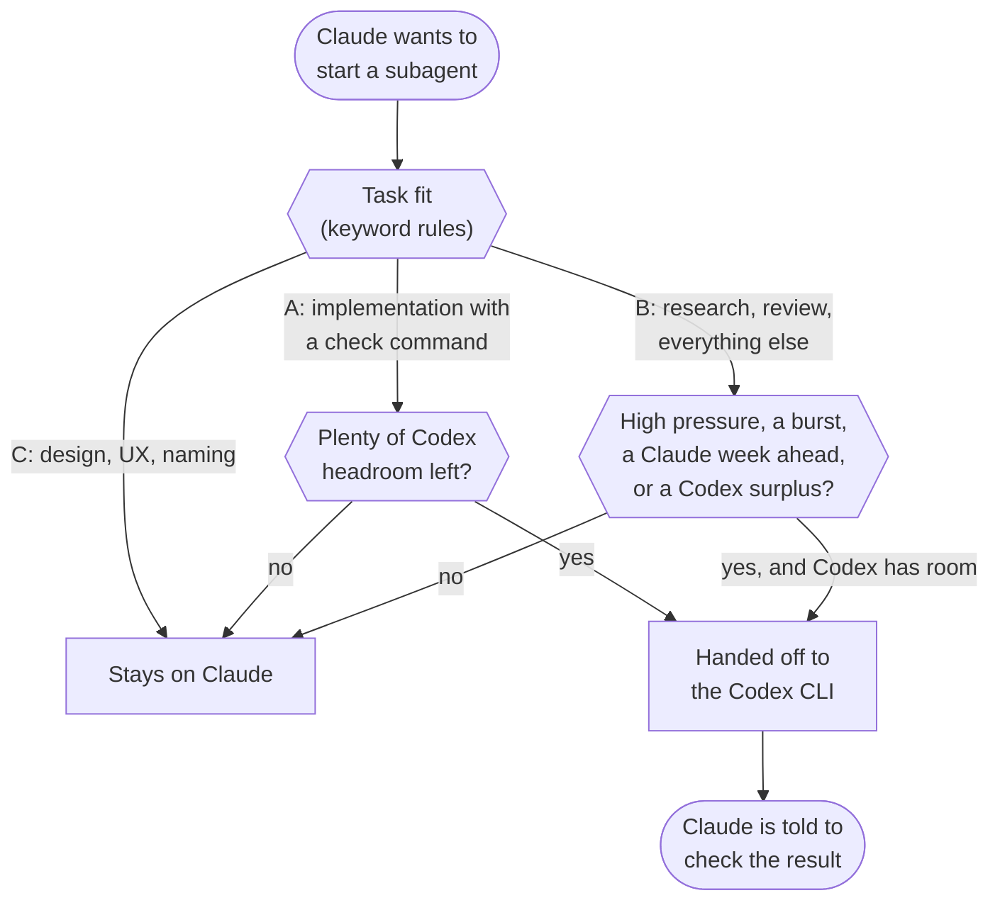

# How agent-crossfeed works

This page explains how crossfeed decides where subagent work runs and what it does about background work. Setup and everyday use are in the [README](../README.md); workflow stages have [their own page](workflow-stages.md); commands, the dispatcher and stored data are in the [reference](reference.md).

## Why

Much of what fills Claude's 5-hour window is execution: subagents, and long
runs of commands and edits. Several subagents started together can fill a
window within half an hour.

Some models also have a weekly limit of their own. In one heavy user's logs
it ran out before its reset three weeks in a row, once 2.3 days into the
week while the all-model week was at 54%. In that week about 28% of the
model's use (weighted by API prices) came from subagents that never asked
for it and inherited it from the main loop.

A usage meter shows how fast you are using Claude, and a delegation
command lets you move one task by hand. crossfeed decides for every
subagent call from the main loop at the moment it starts, and says why.

The name comes from aviation, where crossfeed lets an engine draw fuel from
the other side's tank so that neither runs dry first.

## Overview



The default `auto` mode, for calls Codex can take, while both quotas can be
read. Pressure is a value crossfeed raises while Claude's window is on pace
to fill. [How it routes](#how-it-routes) has the numbers.

## How it routes

For each subagent call from the main loop crossfeed asks four questions.

1. **Fit.** What kind of task is this? The answer comes from keyword rules
   on the call's description and brief.

   | Tier | Work | Handed to Codex in `auto` |
   | --- | --- | --- |
   | A | a brief that names a check command (`pytest`, `npm test`, `cargo test` and similar) and reads as implementation work: implement, refactor, migrate, fix failing tests, reproduce, triage logs | at headroom of at least one half |
   | B | everything else that is eligible: research, reading code, review, implementation without a recognised check command | at pressure of at least 0.3, including the weekly and burst rules below, with any positive headroom |
   | C | briefs under 100 characters, and calls whose description or opening lines contain design, architecture, UX, front-end, naming or brainstorming keywords | never |

2. **Pressure.** How fast is Claude's 5-hour window filling? crossfeed
   forecasts where the window will end at the current pace. It raises a
   pressure value in small steps while that forecast is above 95% and lowers
   it when the forecast is below 80%. Tier B work moves once pressure
   reaches 0.3. Claude's all-models week can also move tier B. The week is
   ahead at 5 percentage points or more above the fraction of the week
   elapsed, or at 90% used, and full at 100%. For example, 55% used
   halfway through the week is ahead. This rule needs a known future reset.

3. **Headroom.** How much Codex quota is left before the reset? A
   headroom value falls from 1 to 0 over the last 10 to 20 points before
   Codex's weekly stop. The stop leaves room for your own Codex work, and
   that room shrinks as the reset gets closer: with the default
   `codexStopPercent` of 85 the stop is 85% when the week starts, 92.5%
   halfway and 100% at the reset, so quota that would expire unused can
   still be handed off. A short window of 6 hours or less gives zero
   headroom at 90%. In `auto`, tier A needs headroom of at least one half
   and tier B needs positive headroom. A job that is already running is
   not stopped. Windows that have reset do not count. On the longest
   window over 6 hours, crossfeed also checks the surplus against an even
   pace that reaches 100% at the reset. Halfway through the week, 25% used
   leaves a surplus of 25 points (50 minus 25). A surplus can move tier B
   even at low pressure when headroom is at least one half and the surplus
   reaches the smaller of 15 points and half of `codexStopPercent`
   multiplied by the fraction of the window remaining. With 21 hours left
   in a seven-day window and the default setting of 85, the threshold is
   about 5.3 points.

4. **Model limits.** Is a model's own weekly limit going too fast?
   crossfeed reads these limits from Claude Code's `/usage` (no model call)
   every 10 minutes or so while you work. A limit counts as ahead when its
   use is 5 points past an even pace for the week, or at 80%. Then a
   subagent call that would run on that model is decided as if pressure
   were 0.3, so tier B work goes to Codex. A `general-purpose`, `claude`, or
   `workflow-subagent` agent that is not a fork, stays on Claude and inherits
   its model is started on `premiumFallback` (Opus by default) when the
   fallback family is cheaper and its own limit is neither ahead nor full.
   Claude Code can keep the original model, for example for a resumed agent. Once the limit is used up, the
   fallback applies to a subagent that named the model too. When your main loop runs on that
   model and main-loop hand-offs are on, the ahead notice asks Claude to
   keep planning, decisions and review here and hand execution to Codex.
   The full notice reports that the limit is used up and names the
   fallback if available or advises handing execution to Codex. Either
   notice can suggest switching to the fallback with `/model` and consulting
   Fable, Opus or Sonnet at key moments with `/advisor`. crossfeed never
   switches your main model itself.

The forecast cannot see subagents that have just started, so two more
rules apply. Once two calls that could have been handed off (tier A or B)
have stayed on Claude within 10 minutes, further tier B calls in that time
go to Codex too, while it has headroom. And a window that begins within two
hours of a locked window's reset starts with pressure already raised; that
start counts for the window's first 30 minutes.

Unknown Codex headroom blocks hand-offs to Codex. Without Claude's 5-hour
reading, a subagent call can still move if its model's weekly limit is
ahead or used up. Weekly signals or `always` can still prompt main-loop
hand-offs with enough headroom. `/crossfeed status` names the reason.
By default a call is considered when it names no
agent type or one of the general-purpose types (the `eligibleTypes`
option). Other agent types, calls pinned to the `haiku` model, named or
remote agents, calls made by a subagent itself, and briefs that mention
browser tools or other Claude-only tools crossfeed recognises stay on
Claude.

**In the main loop**, hand-offs are on when pressure reaches 0.3 with a
5-hour reading, the main model's week or the all-models week is ahead or
full, the Codex surplus is active, or the mode is `always`. Each needs
headroom of at least one half. Mode `off` disables steering. At 90% of
Claude's 5-hour window the reserve takes precedence over every hand-off
notice. Claude is asked to finish the current step, keep a hand-off note
and start no new autonomous work. Subagent calls still use the rules above.

An all-models week ahead or full, an active surplus, or `always` triggers
a balance notice saying “hand-offs are on.” Before the first command of
each task, Claude is asked to hand Codex execution with a result it can
check, such as fixing failing tests or running three dependent shell steps.
Conversation, design decisions, Claude-only tools and edits under about
20 lines stay with Claude. For each ordinary user prompt, the first
counted main-loop call at or beyond `stretchCalls` while hand-offs are on
gives a reminder with the reasons and a `run --kind task` command.

After an on notice, known headroom below one half triggers “hand-offs are
off.” With enough headroom, that notice waits until no reason holds, the
Claude week is on pace and less than 2 points above the even-pace line,
and the Codex surplus is below two thirds of the points it turns on at.
Missing readings alone do not
trigger it. The off notice asks Claude to do execution itself unless a
subagent call is refused.

When weekly usage tips a tier B decision, the refusal gives the figures
from that decision. For example, a command with `--cause codex-surplus`
can have this explanation:

```
Why: tier B; Codex weekly 40% used, 52 points under an even pace to its reset.
```

The exact rules and formulas are in [design.md](design.md).

## Background work

A few workflows running at once can fill the 5-hour
window before the pressure rule reacts, so
crossfeed also checks every agent start Claude Code exposes. The window is
short at `shedPercent` (85% by default), or when the current pace would
fill it within 15 minutes and before its reset. While it is short,
crossfeed refuses new background Claude work, including workflow agents
and descendants of background work. A subagent the main loop waits for
passes this check and follows the usual hand-off rules. At the first reading at or above
the shed line, the breaker selects the background workflows, agents and
teammates this conversation has registered and tries to stop them with
TaskStop. It reports explicit denials and retries those tasks on later
readings at or above the line. A pace crossing while this conversation has
a registered task, or a breaker stop or denial, can wake an idle main loop
with one prompt per window. The count is kept in memory, so it starts over
when the plugin reloads or the conversation is resumed. A pace warning can
arrive before anything stops. Breaker messages name the stopped tasks or
denied stops and how to resume each stopped workflow with a known run ID.
Other messages are queued for Claude's next eligible main-loop tool result
or ordinary prompt and, with `wake` on, also appear as a toast. With `wake`
set to false crossfeed only queues them. Mode `off` turns all of this off.

## What you get

- A routing decision for every subagent call from the main loop, with its
  reason in one line.
  `/crossfeed status` shows the readings, the pressure, what would be
  handed off now, and why the last call was or was not.
- Notices about pressure, weekly balance and the 5-hour reserve, and at
  most one stretch reminder per ordinary user prompt when a counted call
  reaches or passes `stretchCalls` while hand-offs are on.
- Subagents moved off a model whose weekly limit is ahead, each one logged
  and recorded.
- While the 5-hour window is short, crossfeed refuses new background Claude agents. Eligible workflow stages can still run on Codex. At the shed line, the breaker tries to stop this conversation’s registered background tasks.
- A local record of each routing decision outside `off` mode (a decision
  whose write fails is logged and left out), with its reason and the
  readings it rested on, and of every finished job: how long it took, the
  Codex token count it reported, and, when recorded, whether its check
  passed or its result was used. `/crossfeed report` sums up the last 7
  days, including the lockouts it saw.
- A hook fault before admission lets the original call proceed. After a stage routes to Codex, a dispatch fault fails the stage unless `auto` can fall back while the window is open.
- A small footprint: no daemon, no database, no MCP server. The dispatcher
  is one Python file that uses only the standard library, and it also works
  [without the plugin](reference.md#the-dispatcher).

## Measured so far

The first five rows come from one heavy user's Claude Code logs. "Routable"
means a subagent call crossfeed would consider: a general-purpose call with
a brief of 100 characters or more. The last three rows come from building
crossfeed itself, where implementation jobs were given to Codex by hand
with the same kind of brief and check the plugin uses.

| Measure | Result |
| --- | --- |
| Lockouts of the 5-hour window in the 30 days before installing | 6, with Claude locked for 12.9 hours in total |
| Of those, windows in which three or more routable subagents started within 10 minutes | 3 of the 6 |
| Share of a locked window's usage that came from routable subagents | about a quarter (median; 4% to 42%) |
| Fastest burn on record, on the first day installed | 7 routable subagents started within 73 seconds, and the window was full 29 minutes after its reset |
| Share of that window's usage from routable subagents | 63% |
| Implementation jobs handed to Codex with a test command | 10, and all 10 passed their tests on first delivery |
| Codex time per job | 7 minutes (median; 5 to 16) |
| Codex quota used | about 5 points of one week's quota on that user's plan, two review jobs included |

Usage shares are estimates: tokens are weighted by API price ratios,
because the subscription's own weighting is not published. Nothing was
handed off during the fastest burn: version 0.1.0 could not find Codex in
that session. Version 0.1.1 fixed that and added the rule for bursts. A
before and after count of lockouts needs more weeks of use and is not in
yet.

## Limits

- Astra's weight in the Codex weekly allowance and how often Claude
  follows the start-of-task rule have yet to be measured. The 5-point
  all-models pace threshold, the 15-point surplus and its smaller
  threshold near the reset, the Codex reserve that shrinks with the time
  left, the 85% shed line and the 15-minute pace line are judgment calls.
- Concurrent launches can each pass the guard on the same quota reading.
- Switching to or from `off` changes the next composed prompt and may
  cause a cache miss. The static instructions are present in `auto` and
  `always`.

- Hand-offs aim to make lockouts rarer and later. A before and after count
  is not in yet (see [Measured so far](#measured-so-far)), and what the
  hand-offs themselves cost in Claude usage has not been measured.
- The tiers are keyword heuristics informed by published benchmarks and one
  practitioner's routing rules, not by your tasks. They will misfile some
  briefs. `/crossfeed report` shows check results per tier so you can see
  whether they hold for you.
- Subagent calls are counted per session. Subagents started from two
  sessions at once are not seen as one burst, and subagents that are
  already running cannot be moved.
- In a very heavy window only part of the usage can move, so a lockout can
  still happen.
- The breaker acts only on background tasks this conversation registered.
  Claude Code exposes no admission event for some forked skills, and usage
  readings can lag behind requests already in flight.
- A Codex job starts with none of the conversation's context. Thin briefs
  give poor results.
- Running the command in the background and checking the result are
  instructions to the model, not something the plugin can enforce.
- The pressure controller's constants were calculated, not tuned on
  measurements, and most are fixed in code. The model-limit thresholds
  come from replaying three weeks of one user's logs.
- Model limits are read from text Claude Code prints for people. If the
  lines crossfeed reads change, it stops seeing model limits until it is
  updated. If only a reset time cannot be read, it uses the all-model
  weekly reset time, or acts only from 80% when there is none.
- Most of a scarce model's use is usually the main loop, which crossfeed
  does not move. Whether `/advisor` calls count toward the advised model's
  weekly limit has not been measured.
- A Claude lockout still interrupts the conversation. crossfeed hands off
  individual tasks before that point.

## Research behind the design

The routing rules draw on published work on LLM routing, budget pacing and
coding-agent teams. crossfeed does not reproduce these papers' results, and
its own thresholds have not been tuned on measurements yet.

| Paper | What crossfeed takes from it |
| --- | --- |
| Ong et al., [RouteLLM: Learning to Route LLMs with Preference Data](https://arxiv.org/abs/2406.18665) (2024) | Routing is decided per request. "Which model suits this task" is a separate question from "how tight is the budget". |
| Ding et al., [Hybrid LLM: Cost-Efficient and Quality-Aware Query Routing](https://arxiv.org/abs/2404.14618) (2024) | How much work goes to the other model can be tuned at run time. In crossfeed's default mode that tuning comes from pressure: tier B work moves when pressure, or the burst rule, reaches the threshold. |
| Chen, Zaharia and Zou, [FrugalGPT: How to Use Large Language Models While Reducing Cost and Improving Performance](https://arxiv.org/abs/2305.05176) (2023) | Choosing the model per query can cut cost at the same quality. Unlike the paper's cascade, crossfeed routes each call once, because a second attempt would spend quota too. |
| Taberner-Miller, [ParetoBandit: Budget-Paced Adaptive Routing for Non-Stationary LLM Serving](https://arxiv.org/abs/2604.00136) (2026) | Budget pacing as a closed loop. The pressure controller reacts to a forecast of the window in place of a fixed threshold. |
| Qin et al., [Pathwise-Budgeted LLM Routing: Online Allocation with K-Bit Tail-Cost Learning](https://arxiv.org/abs/2611.05835) (2026) | One expensive task can exhaust what is left of a budget, so the controller's line for "too fast" is a forecast of 95%, which leaves a margin below a full window. |
| Samway et al., [Scaling Inference-Time Compute with Teams of Coding Agents](https://arxiv.org/abs/2610.17471) (2026) | What delegation buys depends on the stage that is delegated and on the models in the team. crossfeed judges fit per brief and records outcomes per tier, so its rules can be corrected. |
| Xiang et al., [Cross-Model LLM Code Review: Should you use Claude to review Codex or vice versa?](https://arxiv.org/abs/2607.21656) (2026) | In the paper Claude's review raised Codex drafts from 71.6% to 89.7% on 116 tasks, and the reverse order did not pay off. In crossfeed Codex does the work and Claude is told to check the result before reporting it. |
| Huang et al., [SWE-Shift: Evaluating Coding Agents in Evolving Workspaces](https://arxiv.org/abs/2610.32196) (2026) | Every coding agent the paper tested did worse when the task changed during a run. Tier A asks for a check command in the brief, and briefs that open with design keywords stay on Claude. |

The full source list, including the benchmarks consulted, is in
[design.md](design.md#references).
